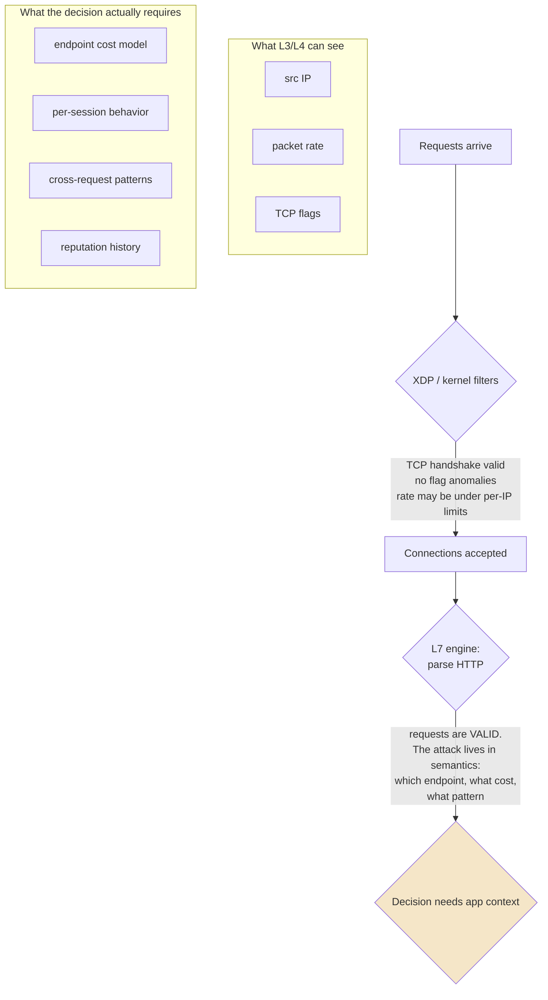
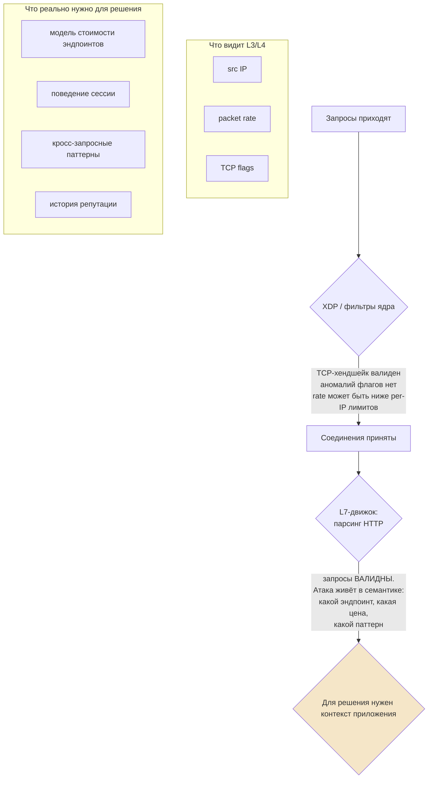

# HTTP Flood: Application-Layer Attack That Looks Like Traffic

> Knowledge Base · Rampart attack fundamentals · Related: [defense-levels.md](../defense-levels.md), [slowloris.md](./slowloris.md), PoW details in [anti-bot research](../../research/anti-bot.md)

## English

## 1. What an L7 flood is

An HTTP flood sends requests that are **syntactically perfect** — valid TCP, valid TLS, valid HTTP — at a rate or cost profile designed to exhaust application resources. There is nothing anomalous about any individual request; the anomaly is statistical (volume, distribution, cost) rather than protocol-level.

Common shapes:

- **GET flood on expensive endpoints** — hammering pages that trigger database joins, search, report generation, or uncached rendering. 100 req/s against `/search?q=...` hurts more than 10,000 req/s against a static asset.
- **POST flood** — form submissions, API writes: each request costs the backend not just CPU but writes, locks, and downstream calls.
- **Cache-busting** — appending a unique query string to every request (`/?t=<random>`, `?utm_<random>=1`) so every response misses the cache and hits origin. The same nominal traffic suddenly multiplies its backend load several-fold.
- **Legitimate-looking traffic** — full TLS with proper SNI, plausible User-Agent headers (or real headless browsers), cookies honored, human-like pacing. Distributed across residential proxies, it defeats naive "is this a datacenter IP" checks.

## 2. Why L3/L4 defense is powerless here

Everything below the application sees a stream of perfectly normal conversations:



Concretely:

- Dropping by rate alone punishes legitimate bursts (a page load fires dozens of requests).
- The attacker's packets pass every sanity check because they *are* sane.
- Per-IP limiting helps only until the botnet spreads across thousands of residential-proxy IPs.

The only layer that can tell `/` from `/expensive-report` and a browser session from a script is one that has parsed the HTTP exchange and holds session state. That is why an L7 flood is decided in userspace — the kernel already lost the information needed for the verdict.

## 3. Defense

### 3.1 Challenge-response gating

Before expensive logic runs, the edge issues a cheap challenge that must be solved before the real request is served. Legitimate browsers solve it transparently; scripts pay a cost. This converts "free requests" into "paid requests" without touching honest users.

### 3.2 SHA256 hashcash proof-of-work with dynamic difficulty

Rampart's core anti-flood mechanism (Layer 2 of the stack). Principle:

1. Edge generates a random per-request challenge token + timestamp + current difficulty `d`.
2. Client must find a nonce such that `SHA256(token || nonce)` begins with characters from an allowed set — on average requiring `16^d` hash attempts (hex output). Difficulty 4 ≈ tens of milliseconds on a phone; difficulty 12 ≈ seconds even on a fast CPU.
3. Client returns `(token, nonce)`; edge verifies with **one** hash (~microseconds) and checks the timestamp (≤30 s window) — challenges are single-use, so replay is impossible.
4. Difficulty is dynamic: driven by global connections-per-second and attack mode.

```mermaid
sequenceDiagram
    participant C as Client
    participant E as Edge (PoW gate)

    C->>E: request arrives during elevated load
    E-->>C: {challenge token, difficulty d, allowed hex, timestamp}
    Note over C: browser loops nonce:<br/>SHA256(token+nonce) starts with d allowed chars<br/>cost: O(16^d) hashes on the CLIENT
    C-->>E: solution {token, nonce}
    Note over E: verify = ONE sha256 + timestamp check<br/>FILTERING POINT: asymmetry —<br/>client pays seconds, server pays microseconds
    E->>E: verified → forward to app logic

    rect rgb(230, 240, 255)
    Note over C,E: Dynamic difficulty: CPS > 500 → d=12, >100 → 10,<br/>>50 → 8, calm → 4. Attack raises everyone's price;<br/>verified/reputation-trusted clients get lower d or skip.
    end
```

The economics are the point: verification is ~10⁶ times cheaper than solving, so the edge can demand work from millions of suspects while spending almost nothing itself. GPU farms don't rescue the attacker much — SHA256 isn't memory-hard but the bottleneck becomes orchestration of millions of solutions, and raising `d` scales their cost exponentially while ours stays flat.

### 3.3 Behavioral analysis

Per-session statistics distinguish humans from scripted floods:

- request pacing and inter-arrival variance (scripts are too regular; instant responses <200 ms are bots),
- endpoint mix (humans browse; bots hammer one URL),
- header order/fingerprint consistency,
- navigation coherence (referers, resource loading order).

Deviations feed a risk score instead of hard-blocking immediately — reducing false positives on NAT users behind one IP.

### 3.4 Reputation scoring

Every source accumulates a score (−100..+100):

| Signal | Effect |
|---|---|
| Passed PoW/challenges before | positive |
| Sent malformed/death-code packets | strong negative, auto-ban |
| ASN category (residential / datacenter / mobile / Tor) | baseline weighting of all limits |
| Anomaly vs 168-hour hourly baseline profile | negative drift |

Reputation multiplies rate limits and sets PoW difficulty: trusted residential client at calm time → difficulty 4, no friction; fresh datacenter IP mid-attack → strictest limits plus difficulty 12. Verified clients (fingerprint cache in Redis, HMAC-SHA256 based, TTL 24 h) skip re-challenges entirely — returning users don't pay twice.

### Summary

| Mechanism | What it stops |
|---|---|
| Challenge-response gate | Free unauthenticated access to expensive logic |
| Hashcash PoW, dynamic difficulty | Mass request generation — makes it economically irrational |
| Behavioral analysis | Bots that solve PoW but act non-human |
| Reputation scoring | Distributed floods via rented residential IPs |

## Русский

## 1. Что такое L7-флад

HTTP-флад шлёт запросы, **синтаксически безупречные** — валидный TCP, валидный TLS, валидный HTTP — с такой интенсивностью и стоимостным профилем, которые истощают ресурсы приложения. В отдельном запросе нет ничего аномального; аномалия статистическая (объём, распределение, стоимость), а не протокольная.

Типичные формы:

- **GET-флад по дорогим эндпоинтам** — долбление страниц, триггерящих джойны в БД, поиск, генерацию отчётов или некэшированный рендеринг. 100 req/s против `/search?q=...` больнее, чем 10 000 req/s по статике.
- **POST-флад** — отправка форм, запись в API: каждый запрос стоит бэкенду не только CPU, но и записей, локов и внешних вызовов.
- **Cache-busting** — добавление уникального query-параметра к каждому запросу (`/?t=<random>`, `?utm_<random>=1`), чтобы каждый ответ был cache-miss и уходил в origin. Тот же номинальный трафик внезапно умножает нагрузку на бэкенд в разы.
- **Маскировка под легитимный трафик** — полный TLS с корректным SNI, правдоподобные User-Agent (или реальные headless-браузеры), обработка cookies, человекоподобный темп. Распределение через резиденциальные прокси ломает наивные проверки «датацентровый ли это IP».

## 2. Почему защита L3/L4 здесь бессильна

Все слои ниже приложения видят поток абсолютно нормальных разговоров:



Конкретно:

- Дроп по одному лишь rate наказывает легитимные всплески (загрузка одной страницы порождает десятки запросов).
- Пакеты атакующего проходят все санити-чеки, потому что они и есть санитарные.
- Per-IP лимиты помогают ровно до тех пор, пока ботнет не размажется по тысячам резиденциальных прокси-IP.

Единственный слой, отличающий `/` от `/expensive-report`, а браузерную сессию от скрипта, — слой, распарсивший HTTP-обмен и держащий состояние сессии. Поэтому L7-флад решается в userspace — ядро уже потеряло информацию, нужную для вердикта.

## 3. Защита

### 3.1 Гейтинг challenge-response

До запуска дорогой логики edge выдаёт дешёвый challenge, который надо решить, прежде чем реальный запрос будет обслужен. Легитимные браузеры решают его прозрачно; скрипты платят цену. «Бесплатные запросы» превращаются в «платные», не трогая честных пользователей.

### 3.2 SHA256 hashcash proof-of-work с динамической сложностью

Ключевой анти-флад механизм Rampart'а (слой 2 стека). Принцип:

1. Edge генерирует случайный per-request токен-challenge + timestamp + текущую сложность `d`.
2. Клиент должен найти nonce, при котором `SHA256(token || nonce)` начинается с символов из разрешённого набора — в среднем требуется `16^d` попыток хеширования (hex-вывод). Сложность 4 ≈ десятки миллисекунд даже на телефоне; сложность 12 ≈ секунды даже на быстром CPU.
3. Клиент возвращает `(token, nonce)`; edge проверяет **одним** хешем (~микросекунды) и проверяет timestamp (окно ≤30 с) — challenge одноразовый, replay невозможен.
4. Сложность динамическая: управляется глобальным CPS и режимом атаки.

```mermaid
sequenceDiagram
    participant C as Клиент
    participant E as Edge (PoW-гейт)

    C->>E: запрос пришёл при повышенной нагрузке
    E-->>C: {challenge token, difficulty d, allowed hex, timestamp}
    Note over C: браузер крутит цикл nonce:<br/>SHA256(token+nonce) начинается с d разрешённых символов<br/>цена: O(16^d) хешей у КЛИЕНТА
    C-->>E: решение {token, nonce}
    Note over E: верификация = ОДИН sha256 + проверка timestamp<br/>ТОЧКА ФИЛЬТРАЦИИ: асимметрия —<br/>клиент платит секундами, сервер микросекундами
    E->>E: верифицирован → вперёд к логике приложения

    rect rgb(230, 240, 255)
    Note over C,E: Динамическая сложность: CPS > 500 → d=12, >100 → 10,<br/>>50 → 8, спокойствие → 4. Атака повышает цену всем;<br/>верифицированные/доверенные клиенты получают низкую d или скип.
    end
```

Экономика — сама суть механизма: верификация в ~10⁶ раз дешевле решения, поэтому edge может требовать работу от миллионов подозреваемых, почти ничего не тратя. GPU-фермы мало помогают атакующему — SHA256 не memory-hard, но узким местом становится оркестрация миллионов решений, а рост `d` масштабирует их цену экспоненциально, тогда как наша остаётся плоской.

### 3.3 Поведенческий анализ

Посессионная статистика отличает людей от скриптовых флудов:

- темп запросов и дисперсия интервалов (скрипты слишком ровные; мгновенные ответы <200 мс — боты),
- микс эндпоинтов (люди гуляют по сайту; боты долбят один URL),
- согласованность порядка заголовков/фингерпринта,
- связность навигации (referer'ы, порядок подгрузки ресурсов).

Отклонения капают в risk-score вместо немедленного жёсткого блока — снижая ложные срабатывания на NAT-пользователей за одним IP.

### 3.4 Reputation scoring

Каждый источник накапливает score (−100..+100):

| Сигнал | Эффект |
|---|---|
| Ранее проходил PoW/challenge | позитив |
| Слал мусорные/death-code пакеты | сильный негатив, авто-бан |
| Категория ASN (residential / datacenter / mobile / Tor) | базовое взвешивание всех лимитов |
| Аномалия против 168-часового почасового baseline | негативный дрейф |

Репутация умножает rate limit'ы и задаёт сложность PoW: доверенный residential-клиент в спокойное время → сложность 4, ноль трения; свежий датацентровый IP посреди атаки → самые строгие лимиты плюс сложность 12. Верифицированные клиенты (кэш fingerprint'ов в Redis на базе HMAC-SHA256, TTL 24 ч) вообще пропускают повторные challenge — вернувшиеся пользователи не платят дважды.

### Итог

| Механизм | Что останавливает |
|---|---|
| Гейт challenge-response | Бесплатный анонимный доступ к дорогой логике |
| Hashcash PoW, динамическая сложность | Массовую генерацию запросов — делает её экономически бессмысленной |
| Поведенческий анализ | Ботов, решивших PoW, но ведущих себя не по-человечески |
| Reputation scoring | Распределённые флуды через арендованные резиденциальные IP |
