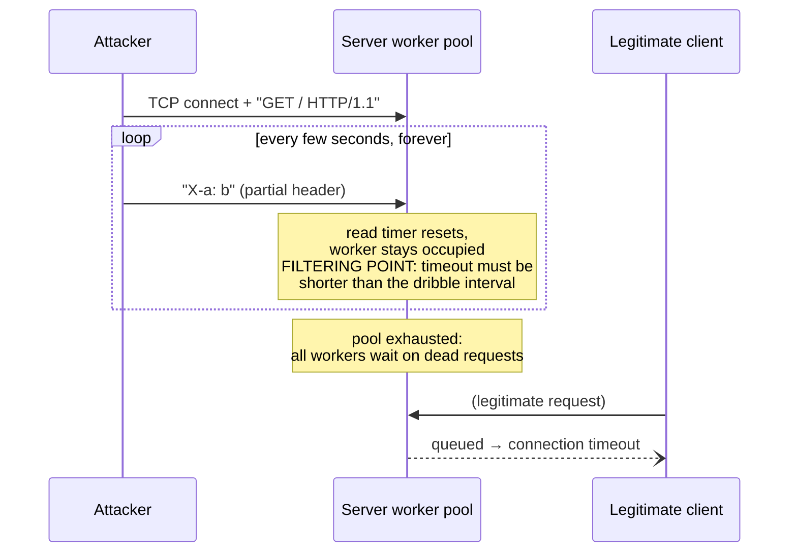
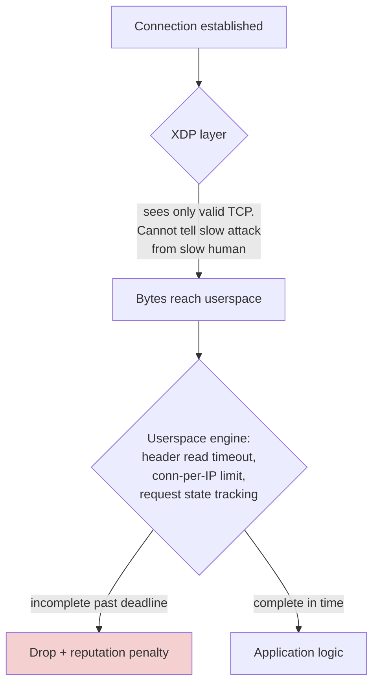
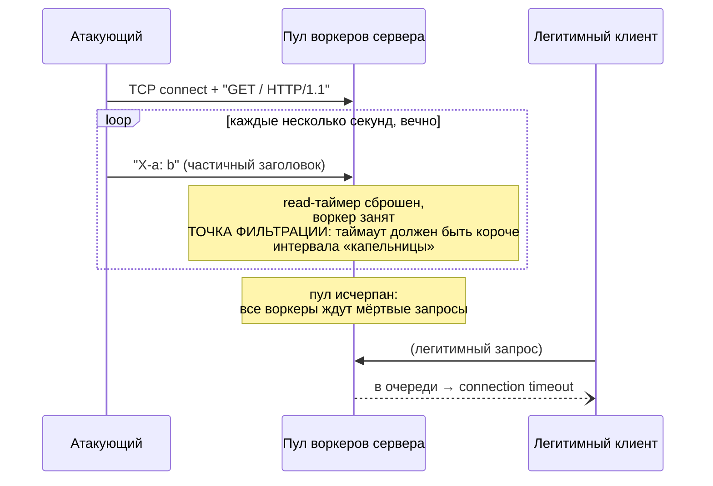
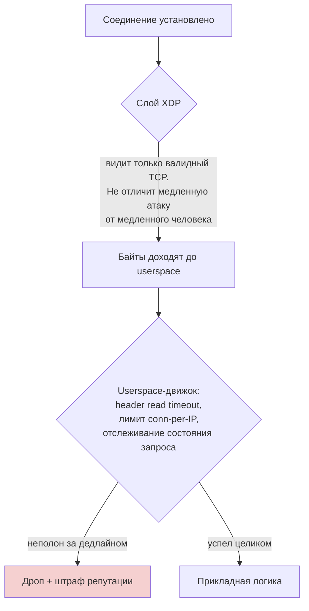

# Slowloris and Slow Attacks: Exhaustion Without Bandwidth

> Knowledge Base · Rampart attack fundamentals · Related: [defense-levels.md](../defense-levels.md), [http-flood.md](./http-flood.md)

## English

## 1. The opposite of a flood

A volumetric attack shouts; a slow attack whispers. Slowloris (named after the original 2009 tool) does not try to overwhelm bandwidth or packet rate — it tries to **occupy every available connection slot with connections that are technically alive but never finish**.

The mechanism exploits how HTTP servers parse requests:

1. Attacker opens a TCP connection and sends `GET / HTTP/1.1`.
2. Then it sends headers one at a time, dribbling out partial headers like `X-a: b\r\n` every few seconds.
3. The server cannot reject the request yet: the header block is incomplete, and by protocol it must keep waiting for `\r\n\r\n` that terminates the header section.
4. Just before the server's read timeout fires, the attacker sends another partial header — resetting the timer.
5. Repeat forever.

Each connection consumes a worker/thread/event-loop slot and a socket buffer while transferring essentially zero bytes. When all workers are busy waiting for "requests in progress", legitimate clients queue behind them and time out.

Hundreds of such connections from a single IP can take down a default-configured web server. The attack traffic is measured in **bytes per minute** — it slips under any volumetric threshold.

## 2. How slow attacks differ from volumetric

| Property | Volumetric (SYN/UDP flood) | Slow (Slowloris family) |
|---|---|---|
| Resource attacked | Bandwidth, backlog, pps budget | Worker pool, sockets, memory per connection |
| Traffic volume | Huge | Tiny |
| Visible at L3/L4? | Yes — flag anomalies, rate spikes | No — packets look perfectly normal TCP |
| Source count needed | Often many IPs | Often one IP is enough |
| Right filter layer | Kernel (XDP) | Userspace, after parsing begins |

This last row matters most: no amount of kernel-level filtering can distinguish a Slowloris connection from a slow human client, because at the byte level they look identical. The decision requires understanding *application state* ("this request has been incomplete for 10 seconds"), which only exists above the kernel.

Variants of the same idea:

- **Slow Read** — complete request, but read the response 1 byte at a time, keeping the socket open.
- **Slow POST / R-U-Dead-Yet** — declare `Content-Length: 1000000`, then send body bytes at a trickle.
- **Slow connection holding** — open and just never send anything (idle hold).

## 3. Defense

### 3.1 Header/body read timeouts — the primary weapon

The server must enforce absolute deadlines independent of incoming bytes:

- **Header deadline**: total time to receive the full header block (e.g. 10 s). Not an idle timeout that the dribble resets — a hard cap from connection start to end-of-headers.
- **Body deadline**: total time to receive declared `Content-Length` bytes, and a sanity cap on the length itself.
- **Idle eviction**: a connection with no bytes for N seconds is closed regardless of state.

In Rampart's userspace engine this is exactly `tokio::time::timeout` around the handshake/read phase — if a full request isn't parsed within the window, the connection is dropped and the source gets a reputation penalty.

### 3.2 Per-IP connection limits

A single IP rarely needs more than a handful of concurrent connections. Enforce:

- max concurrent connections per IP,
- max new connections per second per IP (token bucket),
- global cap on half-parsed requests as a fraction of the pool.

With per-IP caps, one machine running Slowloris can occupy its own quota and nothing else; a distributed variant is then throttled by rate limits plus ASN reputation weighting (datacenter sources get smaller quotas than residential).

### 3.3 Reverse-proxy buffering — shrink the blast radius

Putting a buffering reverse proxy (or Rampart edge itself) in front of the application changes the game:

- The proxy reads the **complete** request before forwarding anything upstream.
- The application's workers only ever see fully-formed requests; slow clients stall proxy buffers, not app threads.
- Proxy buffers are cheap, sized for thousands of stalled connections, and paired with aggressive timeouts from §3.1.

### Why the userspace filter is the main defense here

Kernel layers (XDP, nftables) operate on packets and flags; a slow attack produces perfectly valid packets. The discriminating information — "how long has this request been incomplete, how many such requests does this IP hold" — lives in application-level session state. Hence: cheap kernel layers still handle the volumetric shield, but **the userspace engine is where slow attacks actually get decided**, which is why Rampart places its timeout/reputation logic there rather than trying to push everything into eBPF.

## Русский

## 1. Полная противоположность фладу

Объёмная атака кричит; медленная атака шепчет. Slowloris (назван по одноимённому инструменту 2009 года) не пытается задавить полосу или pps — он пытается **занять все слоты соединений соединениями, которые формально живы, но никогда не завершаются**.

Механизм эксплуатирует то, как HTTP-серверы парсят запросы:

1. Атакующий открывает TCP-соединение и шлёт `GET / HTTP/1.1`.
2. Затем отправляет заголовки по одному, выпуская частичные заголовки вроде `X-a: b\r\n` раз в несколько секунд.
3. Сервер пока не может отклонить запрос: блок заголовков неполон, и по протоколу он обязан ждать завершающие `\r\n\r\n`.
4. За мгновение до срабатывания read-таймаута атакующий шлёт ещё один частичный заголовок — таймер сбрасывается.
5. И так бесконечно.

Каждое соединение занимает слот воркера/потока/события цикла и сокетный буфер, передавая фактически ноль байт. Когда все воркеры ждут «запросы в процессе», легитимные клиенты встают в очередь и отваливаются по таймауту.

Несколько сотен таких соединений с одного IP кладут веб-сервер с дефолтной конфигурацией. Трафик атаки измеряется в **байтах в минуту** — под любой объёмный порог не попадает.

## 2. Чем медленные атаки отличаются от объёмных

| Свойство | Объёмные (SYN/UDP flood) | Медленные (семейство Slowloris) |
|---|---|---|
| Атакуемый ресурс | Полоса, backlog, бюджет pps | Пул воркеров, сокеты, память на соединение |
| Объём трафика | Огромный | Крошечный |
| Видно на L3/L4? | Да — аномалии флагов, всплески rate | Нет — пакеты выглядят абсолютно нормальным TCP |
| Сколько нужно источников | Часто много IP | Часто хватает одного |
| Правильный слой фильтрации | Ядро (XDP) | Userspace, после начала парсинга |

Последняя строка важнее всего: никакая фильтрация уровня ядра не отличит Slowloris-соединение от медленного человеческого клиента — на уровне байтов они идентичны. Решение требует понимания *прикладного состояния* («этот запрос неполон уже 10 секунд»), которого у ядра просто нет.

Варианты той же идеи:

- **Slow Read** — запрос полный, но ответ читается по 1 байту, сокет держится открытым.
- **Slow POST / R-U-Dead-Yet** — объявляется `Content-Length: 1000000`, затем тело капает по байтам.
- **Удержание соединения** — открыть и вообще ничего не слать (idle-hold).

## 3. Защита

### 3.1 Таймауты на чтение заголовков/тела — главное оружие

Сервер обязан держать абсолютные дедлайны независимо от входящих байтов:

- **Дедлайн заголовков**: общее время на получение полного блока заголовков (например, 10 с). Не idle-таймаут, который «капельница» сбрасывает, а жёсткий лимит от начала соединения до конца заголовков.
- **Дедлайн тела**: общее время на получение заявленных `Content-Length` байт плюс санитарный потолок на саму длину.
- **Evict по простою**: соединение без единого байта N секунд закрывается независимо от состояния.

В userspace-движке Rampart это ровно `tokio::time::timeout` вокруг фазы хендшейка/чтения — если полный запрос не распарсен в окно, соединение дропается, источник получает штраф репутации.

### 3.2 Лимиты соединений per IP

Одному IP редко нужно больше горстки одновременных соединений. Вводим:

- максимум одновременных соединений на IP,
- максимум новых соединений в секунду на IP (token bucket),
- глобальный потолок на долю недопарсенных запросов в пуле.

При per-IP квотах одна машина со Slowloris занимает только свою квоту и больше ничего; распределённый вариант затем душится rate limit'ами и весами ASN-репутации (датацентровые источники получают меньшие квоты, чем residential).

### 3.3 Буферизация reverse-proxy — сузить радиус поражения

Буферизирующий reverse-proxy (или сам edge Rampart'а) перед приложением меняет правила игры:

- Прокси читает **полный** запрос до пересылки чего-либо наверх.
- Воркеры приложения видят только полностью сформированные запросы; медленные клиенты упираются в буферы прокси, а не в потоки приложения.
- Буферы прокси дёшевы, рассчитаны на тысячи зависших соединений и работают в паре с агрессивными таймаутами из §3.1.

### Почему userspace-фильтр здесь главный

Ядерные слои (XDP, nftables) оперируют пакетами и флагами; медленная атака производит идеально валидные пакеты. Различающая информация — «как долго этот запрос остаётся незавершённым и сколько их у этого IP» — живёт в прикладном состоянии сессии. Поэтому: дешёвые ядерные слои продолжают держать объёмный щит, но **медленные атаки реально решаются в userspace-движке** — именно поэтому Rampart размещает там логику таймаутов и репутации, а не пытается затолкать всё в eBPF.
