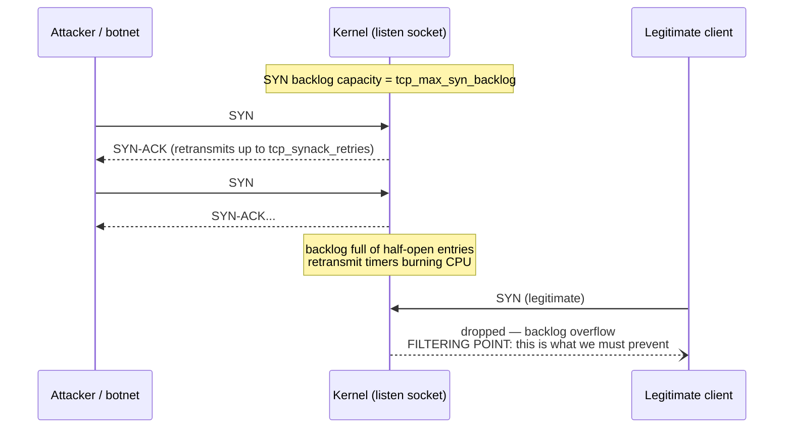
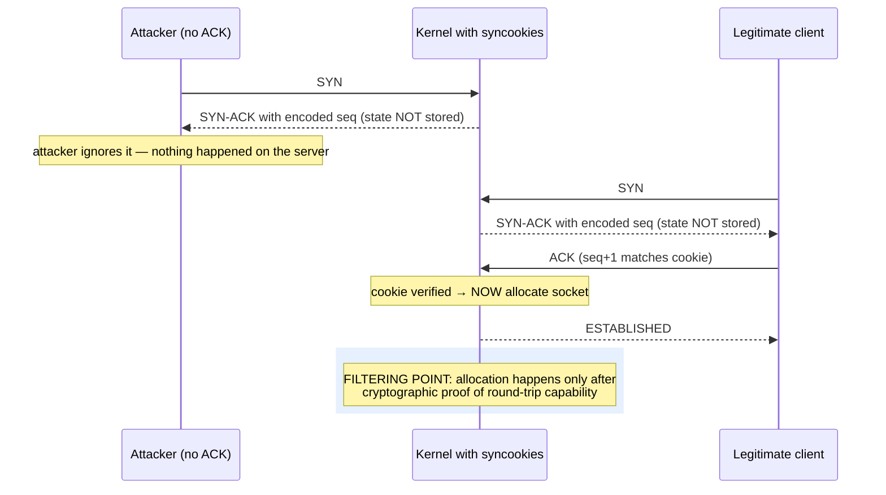
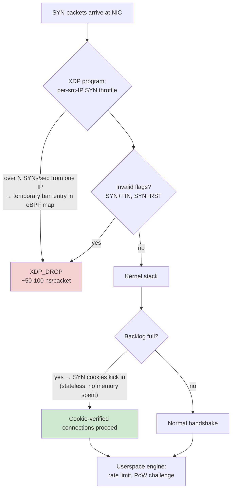
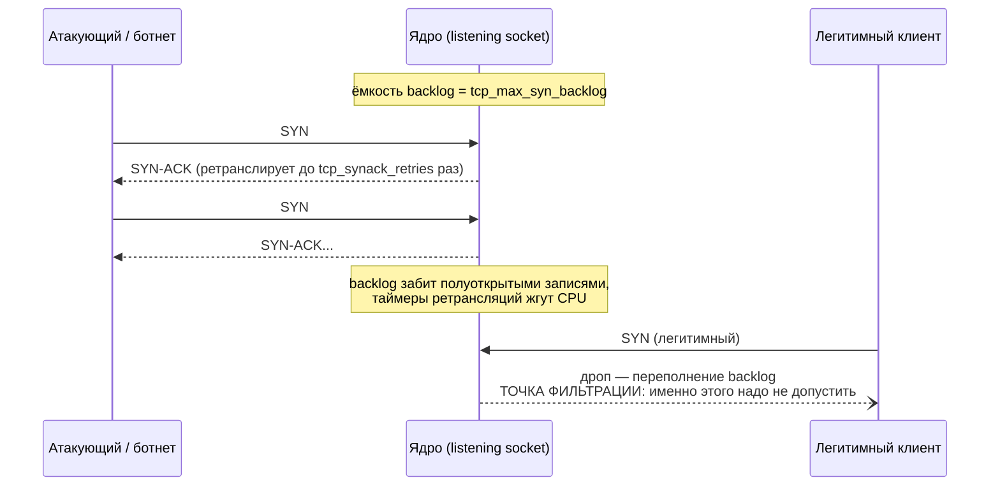
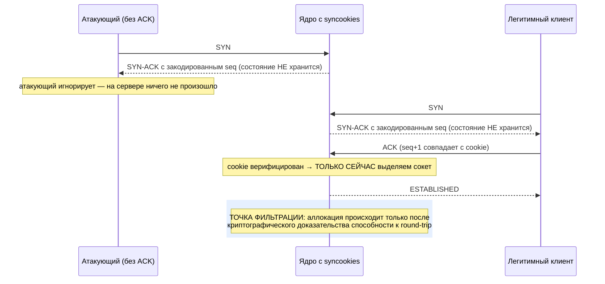
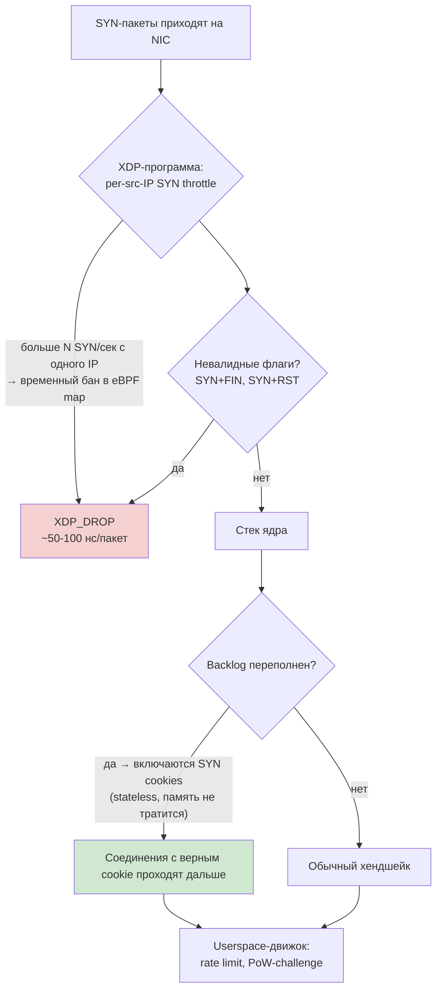

# SYN Flood: Anatomy of the Classic TCP Attack

> Knowledge Base · Rampart attack fundamentals · Related: [kernel-tuning.md](../practice/kernel-tuning.md), [defense-levels.md](../defense-levels.md)

## English

## 1. The TCP handshake, briefly

Every TCP connection starts with a three-way handshake:

1. **SYN** — the client sends a packet with the SYN flag and its initial sequence number (ISN).
2. **SYN-ACK** — the server replies with SYN+ACK and its own ISN.
3. **ACK** — the client confirms; the connection moves to `ESTABLISHED`.

Between steps 1 and 3, the connection is **half-open**: the server has already allocated memory for it in a special queue called the **SYN backlog** (`tcp_max_syn_backlog`), waiting for the final ACK. A half-open connection lives until `tcp_synack_retries` retransmissions are exhausted (default ~1 minute).

This asymmetry is the whole problem: **the attacker spends one packet per half-open connection, the server spends memory + a timer + a potential retransmission.**

## 2. How the attack works

The attacker floods the target with SYN packets and never sends the final ACK (or spoofs an unreachable source IP, so SYN-ACKs go nowhere). The backlog fills up with dead half-open connections. When it is full, legitimate SYNs are dropped — the service becomes unreachable.



Key point: the victim never sees an error — connections simply time out. From the user's perspective the port is "down" even though the machine may be nearly idle.

## 3. Attack variants

| Variant | Source addresses | Difficulty | Why it works |
|---|---|---|---|
| **Single-IP flood** | One real IP | Trivial | Only viable against hosts without per-source limiting; one IP can still open tens of thousands of half-open sockets |
| **Distributed (botnet)** | Many real IPs | Low | Each bot opens a few hundred half-open connections; per-IP limits are diluted across thousands of sources |
| **Spoofed source IPs** | Random / unreachable IPs | Medium | SYN-ACK goes to a third party; the attacker pays 1 packet per connection, the server pays memory + retransmissions; per-IP limiting is useless because each "source" appears once |

Spoofed floods are the most dangerous variant: rate-limiting by source IP cannot help when every packet has a fresh fake address.

## 4. SYN cookies: stateless handshake

SYN cookies move the connection state out of server memory and into the wire. Instead of allocating a backlog entry, the server encodes everything it needs to know into the sequence number of its own SYN-ACK:

```
SYN-ACK seq = MD5/IP-hash(secret, src_ip, src_port, dst_ip, dst_port)   ← top 24 bits
            + timestamp mod 2^6                                         ← middle 5 bits (rotating)
            + MSS encoding                                              ← low 3 bits
```

When the final ACK arrives, the server recomputes the expected value from the ACK number. If it matches, the connection was legitimately completed — *and only then* does the kernel allocate a socket. No backlog entry was ever consumed by the attacker.



### Trade-offs

SYN cookies are not free:

- **TCP options are lost** — window scale, SACK, timestamps cannot be negotiated because there are no bits left in the sequence number (the Linux workaround stores a small MSS code only). Legitimate clients get degraded connections while cookies are active.
- **No retransmission bookkeeping** — the kernel does not remember outstanding SYN-ACKs, so behavior under packet loss differs slightly from the normal path.
- **CPU cost** — a hash computation per SYN instead of a table insert; negligible normally, measurable at millions of pps.
- They activate only under backlog pressure (`net.ipv4.tcp_syncookies = 1`, value `2` = always on), so they are a **fallback**, not the first line.

## 5. Defense layering in Rampart

The correct order of defense is cheapest-first: kill the flood before the kernel ever touches its backlog.



Layer responsibilities:

1. **XDP SYN throttle (first line)** — a token-bucket or fixed-window counter per source IP in an eBPF LRU map. More than N SYNs/sec from one address → drop in the driver, before `sk_buff` allocation. This handles single-IP floods entirely and blunts distributed ones.
2. **Kernel sysctls (second line)** — `tcp_syncookies=1`, enlarged `tcp_max_syn_backlog` and `somaxconn`, reduced `tcp_synack_retries`. Full list and rationale: [kernel-tuning.md](../practice/kernel-tuning.md).
3. **Userspace engine (third line)** — connections that complete the handshake face per-IP connection rate limiting and a proof-of-work challenge before any application logic runs.

## Русский

## 1. TCP-хендшейк вкратце

Каждое TCP-соединение начинается с трёхстороннего рукопожатия:

1. **SYN** — клиент шлёт пакет с флагом SYN и своим начальным номером последовательности (ISN).
2. **SYN-ACK** — сервер отвечает SYN+ACK со своим ISN.
3. **ACK** — клиент подтверждает; соединение переходит в `ESTABLISHED`.

Между шагами 1 и 3 соединение является **полуоткрытым (half-open)**: сервер уже выделил под него память в специальной очереди — **SYN backlog** (`tcp_max_syn_backlog`) — и ждёт финальный ACK. Полуоткрытое соединение живёт до исчерпания ретрансмиссий `tcp_synack_retries` (по умолчанию около минуты).

В этой асимметрии и вся проблема: **атакующий тратит один пакет на каждое полуоткрытое соединение, сервер — память + таймер + потенциальную ретрансмиccию.**

## 2. Как работает атака

Атакующий заваливает цель SYN-пакетами и никогда не отправляет финальный ACK (или подделывает недостижимый исходный IP — тогда SYN-ACK уходят в никуда). Backlog заполняется мёртвыми полуоткрытыми соединениями. Когда он переполнен, легитимные SYN дропаются — сервис становится недоступен.



Важный момент: жертва не видит никакой ошибки — соединения просто отваливаются по таймауту. Со стороны пользователя порт «лежит», хотя машина может быть почти простаивает.

## 3. Варианты атаки

| Вариант | Адреса источника | Сложность | Почему работает |
|---|---|---|---|
| **Флад с одного IP** | Один реальный IP | Тривиально | Работает только против хостов без per-source лимитов; один IP всё равно открывает десятки тысяч полусокетов |
| **Распределённый (ботнет)** | Много реальных IP | Низко | Каждый бот держит несколько сотен полуоткрытых соединений; per-IP лимиты размываются по тысячам источников |
| **Поддельные source IP** | Случайные / недостижимые IP | Средне | SYN-ACK уходит третьей стороне; атакующий платит 1 пакет за соединение, сервер — памятью и ретрансляциями; per-IP лимитирование бесполезно, ведь каждый «источник» появляется один раз |

Спуфинг-вариант самый опасный: ограничение по source IP бессмысленно, когда каждый пакет приходит с нового поддельного адреса.

## 4. SYN cookies: stateless-хендшейк

SYN cookies выносят состояние соединения из памяти сервера прямо в сеть. Вместо выделения записи в backlog сервер кодирует всю нужную информацию в номере последовательности собственного SYN-ACK:

```
SYN-ACK seq = hash(secret, src_ip, src_port, dst_ip, dst_port)   ← старшие 24 бита
            + timestamp mod 2^6                                  ← средние 5 бит (ротация)
            + кодировка MSS                                      ← младшие 3 бита
```

Когда приходит финальный ACK, сервер пересчитывает ожидаемое значение из номера ACK. Если совпало — соединение завершено легитимно, и *только тогда* ядро выделяет сокет. Атакующий не израсходовал ни одной записи backlog.



### Trade-offs

SYN cookies не бесплатны:

- **Потеря TCP-опций** — window scale, SACK, timestamps согласовать нельзя: в номере последовательности нет свободных бит (в Linux сохраняется только небольшой код MSS). Легитимные клиенты получают ухудшенные соединения, пока cookies активны.
- **Нет учёта ретрансляций** — ядро не помнит отправленные SYN-ACK, поэтому поведение при потерях немного отличается от нормального пути.
- **Стоимость CPU** — хеш на каждый SYN вместо вставки в таблицу; обычно незаметно, но измеримо при миллионах pps.
- Cookies включаются только при давлении на backlog (`net.ipv4.tcp_syncookies = 1`, значение `2` = всегда) — это **резервный механизм**, а не первая линия обороны.

## 5. Эшелонированная защита в Rampart

Правильный порядок защиты — от дешёвого к дорогому: убить флад до того, как ядро вообще тронет свой backlog.



Ответственность слоёв:

1. **XDP SYN throttle (первая линия)** — token bucket или fixed-window счётчик на source IP в eBPF LRU map. Больше N SYN/сек с одного адреса → дроп в драйвере, до выделения `sk_buff`. Это полностью закрывает одно-IP флуды и ослабляет распределённые.
2. **Sysctls ядра (вторая линия)** — `tcp_syncookies=1`, увеличенные `tcp_max_syn_backlog` и `somaxconn`, сниженный `tcp_synack_retries`. Полный список и обоснование: [kernel-tuning.md](../practice/kernel-tuning.md).
3. **Userspace-движок (третья линия)** — соединения, прошедшие хендшейк, упираются в per-IP rate limit и proof-of-work challenge до запуска любой прикладной логики.
