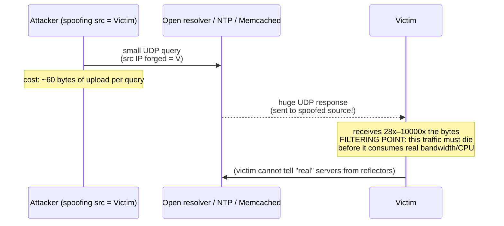
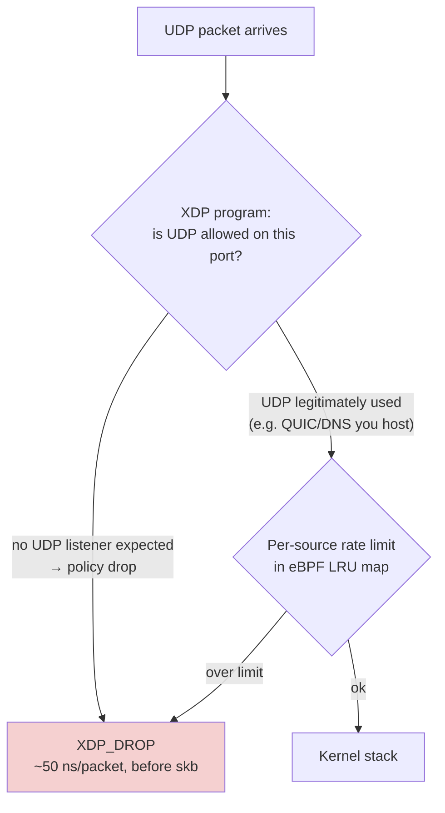
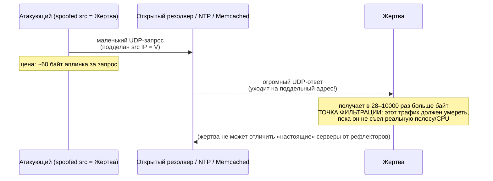
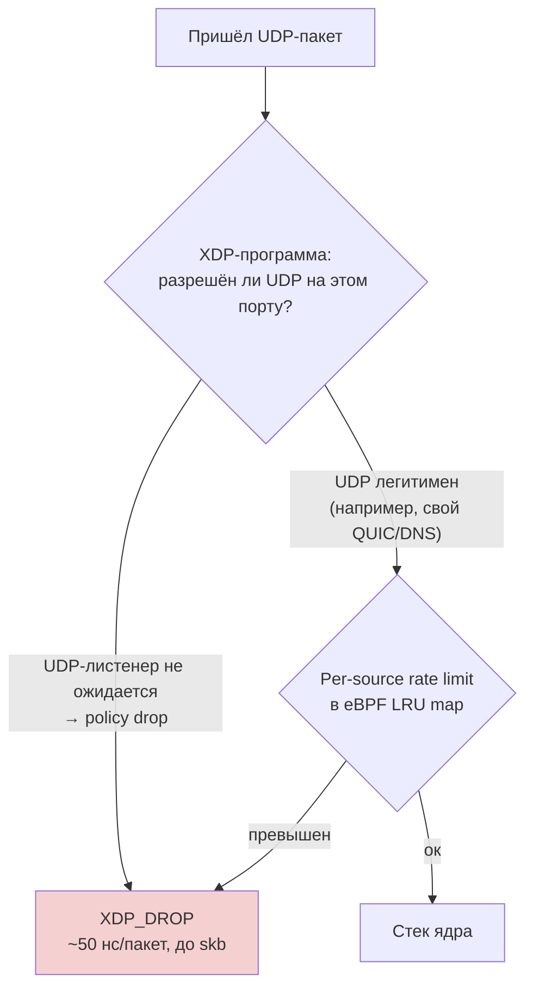

# UDP Amplification: Small Request, Giant Answer

> Knowledge Base · Rampart attack fundamentals · Related: [defense-levels.md](../defense-levels.md), [syn-flood.md](./syn-flood.md)

## English

## 1. Why UDP is the attacker's favorite protocol

UDP is connectionless: anyone can send a packet to any port without ever completing a handshake, and the receiving service will answer. This enables two abuses at once:

- **Reflection** — the attacker sets the *source* IP of their request packets to the victim's address. The open UDP service then sends its reply to the victim, not to the attacker. The victim sees traffic coming from thousands of legitimate DNS/NTP/Memcached servers around the world — attribution and blocking become hard.
- **Amplification** — if the response is much larger than the request, every attacker byte is multiplied. The attack bandwidth is no longer limited by the botnet's uplink but by the amplification factor of the abused protocol.

Combined: a botnet with 1 Gbps of egress can generate tens or hundreds of Gbps of inbound traffic.

The attacker never sees the responses and doesn't care — the goal is the victim's pipe, not a conversation.

## 2. Amplification factors

Measured as `response size / request size` for a single well-formed query:

| Protocol | Request | Response | Amplification factor |
|---|---|---|---|
| **DNS** (open resolver, ANY/other records) | ~60 B query | up to ~3 KB response | **~28–54x** |
| **NTP** (`monlist` on old versions) | ~234 B command | up to ~130 KB list of peers | **~556x** |
| **Memcached** (exposed UDP port 11211) | ~15 B `get` command | megabytes of cached data, chunked into datagrams | **~10,000x+** |

Memcached deserves special mention: a single exposed instance with a few GB of cache turns a tiny botnet into a terabit-class event — the largest recorded volumetric attacks have used exactly this vector.

Other commonly abused protocols follow the same pattern: Chargen (~356x), SNMP (~6x), SSDP (~30x), CoAP (~10x), Portmapper (~28x).

Why does this work? Because these are legitimate services answering what looks like a legitimate question. The reflector is a victim too — it did nothing wrong except being open to the internet with UDP.

## 3. Defense

Defense against amplification has three distinct levels, each belonging to a different party:

### 3.1 BCP38 at the upstream — kill spoofing at the source

BCP38 ("Network Ingress Filtering") means the ISP verifies that packets leaving a customer network carry source addresses that actually belong to that customer. If every upstream performed BCP38 filtering (uRPF loose/strict mode), reflection attacks would be impossible by construction — you cannot spoof an address whose route points elsewhere.

This is outside the victim's control; it must be demanded from providers. When choosing hosting/upstream, BCP38 compliance is a real selection criterion.

### 3.2 UDP policy drop on the edge — your own first line

If your service speaks TCP only (as Rampart's protected services do), then **every incoming UDP packet to your public ports is noise by definition**. Drop it in XDP, before the kernel allocates a socket buffer:

Rules of thumb:

- No UDP service on the port → drop all UDP there.
- Legitimate UDP service → strict per-source rate limiting + response-size caps; never run Memcached-style protocols on public ports.
- Fragmented UDP → drop first fragments with MF flag set unless fragmentation is genuinely needed.

Because XDP drops happen in the NIC driver (~tens of nanoseconds per packet), even multi-million-pps floods consume a fraction of one core instead of saturating the machine.

### 3.3 Rate limiting per source — for the unavoidable remainder

Traffic you cannot classify away (legitimate UDP protocols) gets token-bucket limits per source IP and per subnet in eBPF maps, plus ASN-based reputation weighting (datacenter sources get stricter budgets than residential). Persistent offenders graduate to a blacklist synced across edge nodes.

### Summary table

| Level | Who deploys | What it stops |
|---|---|---|
| BCP38 / uRPF upstream | Providers | Spoofing itself — removes the root cause |
| XDP UDP policy drop | You | The flood reaching kernel/userspace at all |
| Per-source rate limit | You | Abuse of UDP ports you actually need |

## Русский

## 1. Почему UDP — любимый протокол атакующего

UDP не требует соединения: любой может отправить пакет на любой порт, не завершая хендшейк, и сервис ответит. Это открывает сразу две возможности для злоупотребления:

- **Reflection (рефлексия)** — атакующий подменяет *source*-адрес своих запросов на адрес жертвы. Открытый UDP-сервис шлёт ответ жертве, а не атакующему. Жертва видит трафик с тысяч легитимных DNS/NTP/Memcached-серверов по всему миру — атрибуция и блокировка резко усложняются.
- **Amplification (усиление)** — если ответ сильно больше запроса, каждый байт атакующего умножается. Полоса атаки больше не ограничена аплинком ботнета, а определяется коэффициентом усиления эксплуатируемого протокола.

Вместе: ботнет с исходящими 1 Гбит/с генерирует десятки и сотни Гбит/с входящего трафика.

Ответы атакующему не нужны и не интересны ему — цель полоса жертвы, а не диалог.

## 2. Коэффициенты усиления

Измеряется как `размер ответа / размер запроса` для одного корректного запроса:

| Протокол | Запрос | Ответ | Коэффициент усиления |
|---|---|---|---|
| **DNS** (открытый резолвер, ANY и др.) | запрос ~60 Б | ответ до ~3 КБ | **~28–54x** |
| **NTP** (`monlist` на старых версиях) | команда ~234 Б | список пиров до ~130 КБ | **~556x** |
| **Memcached** (открытый UDP-порт 11211) | команда `get` ~15 Б | мегабайты кэша, разбитые на датаграммы | **~10000x+** |

Memcached заслуживает отдельного упоминания: один открытый инстанс с парой гигабайт кэша превращает крошечный ботнет в терабитное событие — крупнейшие задокументированные объёмные атаки использовали именно этот вектор.

Другие часто эксплуатируемые протоколы работают так же: Chargen (~356x), SNMP (~6x), SSDP (~30x), CoAP (~10x), Portmapper (~28x).

Почему это работает? Потому что это легитимные сервисы, отвечающие на внешне легитимный вопрос. Рефлектор тоже жертва — он ничего плохого не сделал, просто был открыт в интернет по UDP.

## 3. Защита

Защита от амплификации существует на трёх уровнях, и каждый принадлежит разной стороне:

### 3.1 BCP38 на аплинке — убить спуфинг в зародыше

BCP38 («Network Ingress Filtering») означает, что провайдер проверяет: пакеты, покидающие клиентскую сеть, несут source-адреса, реально принадлежащие этой сети. Если бы все аплинки делали BCP38-фильтрацию (uRPF loose/strict), атаки отражением стали бы невозможны конструктивно — нельзя подделать адрес, чей маршрут ведёт в другое место.

Это вне контроля жертвы; этого нужно требовать от провайдеров. При выборе хостинга/аплинка соответствие BCP38 — реальный критерий отбора.

### 3.2 UDP policy drop на edge — ваша первая линия

Если ваш сервис говорит только по TCP (как защищаемые Rampart'ом сервисы), то **каждый входящий UDP-пакет на публичные порты — шум по определению**. Дропайте его в XDP, до того как ядро выделит сокет-буфер:

Практические правила:

- На порту нет UDP-сервиса → дропать весь UDP там.
- Легитимный UDP-сервис есть → строгий per-source rate limit + ограничение размера ответа; Memcached-подобные протоколы наружу никогда не выставлять.
- Фрагментированный UDP → дропать первый фрагмент с флагом MF, если фрагментация действительно не нужна.

Поскольку XDP-дроп происходит в драйвере NIC (~десятки наносекунд на пакет), даже многомиллионный pps-флад съедает долю одного ядра вместо насыщения машины.

### 3.3 Rate limit per source — для неизбежного остатка

Трафик, который нельзя классифицировать прочь (легитимные UDP-протоколы), получает token-bucket лимиты на source IP и подсеть в eBPF-мапах плюс взвешивание по ASN-репутации (датацентровым источникам — более строгие бюджеты, чем residential). Устойчивые нарушители попадают в blacklist, синхронизируемый между edge-нодами.

### Сводная таблица

| Уровень | Кто внедряет | Что останавливает |
|---|---|---|
| BCP38 / uRPF у аплинка | Провайдеры | Сам спуфинг — устраняет первопричину |
| XDP UDP policy drop | Вы | Достижение фладом ядра/userspace вообще |
| Per-source rate limit | Вы | Злоупотребление нужными вам UDP-портами |
