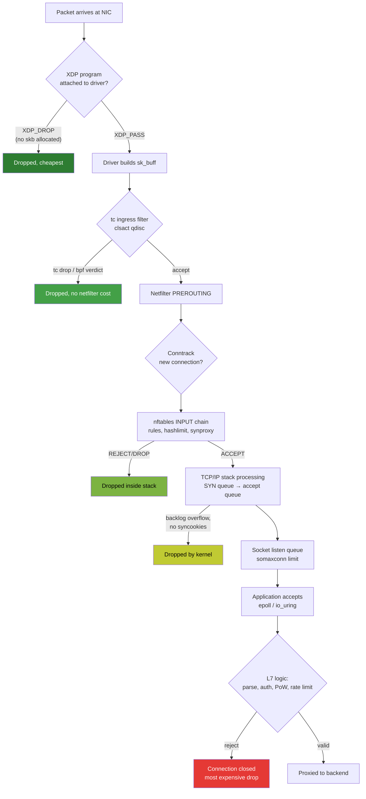
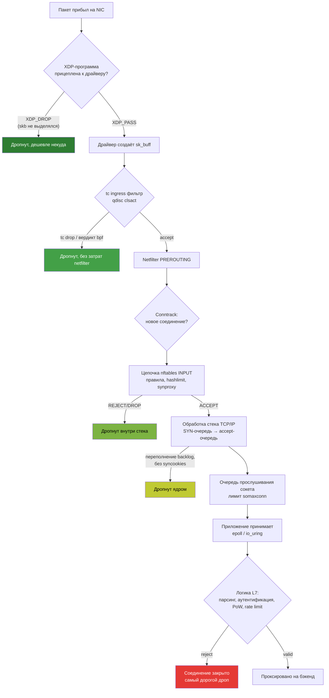

# Where to Filter Traffic: Comparing Defense Levels

> Knowledge Base · Rampart networking fundamentals
>
> The single most important architectural decision in a network protection system is **where** in the packet's journey you decide to drop it. Every level further down the stack costs more CPU per packet and gives you more information per packet. This document compares the levels, shows the full path of a packet through the Linux network stack, and explains why Rampart uses a hybrid kernel fast-path + userspace smart-path design.

## English

## 1. The core trade-off

There is an inverse relationship between **how early** you can inspect a packet and **how much** you can know about it:

- Early (kernel, pre-skb): you see raw bytes — Ethernet header, IP header, TCP header. Inspection is nearly free, but you cannot see application semantics.
- Late (userspace proxy): you see fully reassembled protocol streams — handshakes, requests, sessions. Inspection is expensive per byte, but the decision quality is much higher.

Good defense puts cheap decisions first and expensive decisions last.

## 2. Comparison of filtering levels

| Level | Hook point | When packet is dropped | Latency added per packet | CPU cost per packet | What can be checked | Development complexity |
|---|---|---|---|---|---|---|
| **XDP / eBPF** | NIC driver (or generic), before `skb` allocation | Before the kernel allocates `sk_buff`, before any socket work | ~tens of ns; drop happens right after DMA | Lowest: no skb alloc, no conntrack unless you opt in. Native mode: 15–20M pps dropped per core on modern hardware; generic mode (virtio): ~3–5M pps | Raw L2/L3/L4 headers: IP validation, TCP flags sanity (SYN+FIN, SYN+RST), port allowlists, per-IP rate limits, blacklist/whitelist maps, SYN cookies implemented manually, simple state machines (e.g., SYN → SYN-ACK seen?) | High: C with eBPF verifier constraints (no unbounded loops in older kernels, pointer arithmetic rules, map-based state only); hard to debug |
| **tc / eBPF** (`clsact` qdisc) | Traffic control layer, after skb exists, both ingress & egress | After `skb` allocation but before netfilter and before the socket lookup | Low, slightly above XDP-generic | Medium-low: skb already allocated; still cheaper than netfilter chains for pure header logic | Everything XDP sees, plus: packet marks, classification into qdiscs, egress shaping, works on all interfaces including those without native XDP support (bridges, bonds in some setups) | High-ish: same eBPF verifier, plus tc filter plumbing (`tc filter add ... bpf`) |
| **nftables / iptables** (netfilter hooks) | `PREROUTING`, `INPUT`, `FORWARD`, `OUTPUT`, `POSTROUTING` | Inside the kernel network stack, before delivery to the socket | Low-to-medium; each rule is evaluated linearly | Medium: full hook chain traversal, optional conntrack (which itself costs memory and CPU per connection) | L3/L4 matching (addr/port/proto), conntrack state (`ESTABLISHED` vs `NEW`), rate limiting (`hashlimit`, `recent`), set-based lookups (nftables sets/maps), SYN proxying (`synproxy`), basic string matching (expensive) | Low-medium: declarative config, well documented, no verifier; but limited to what matches exist |
| **Userspace reverse proxy** (nginx / HAProxy / Envoy / custom Rust engine like Rampart edge) | Socket receive queue → application event loop (epoll/io_uring) | After the kernel has done the full TCP handshake and delivered bytes to userspace | Highest: syscall overhead, context switches, copies; measured in microseconds | Highest: full TCP state machine per connection, socket buffers, epoll wakeups. But cost is **per connection**, not per packet | Full L7 semantics: protocol parsing, request validity, authentication, PoW challenges, session behavior, per-client rate limiting, reputation, dynamic difficulty, TLS termination | Low-medium: normal programming language, easy testing; but every attack connection consumes kernel socket resources until you close it |

Key numbers to internalize (order-of-magnitude, hardware-dependent):

```
XDP native drop:        ~50–100 ns/packet, millions of pps per core
XDP generic drop:       a few hundred ns/packet (extra copy driver→skb path)
nftables drop:          hundreds of ns to µs (rule count dependent)
conntrack entry:        ~300 bytes RAM per tracked connection
Userspace accept+drop:  ~10–20 µs CPU per connection (epoll, Rust/C)
                        ≈ 80k new conn/s per core for a real L7 handler
```

The practical consequence: if a 5M pps flood reaches your userspace proxy, your proxy dies doing `accept()` calls that produce nothing. If the same flood hits XDP_DROP, it burns ~one core at most.

## 3. Packet path through the Linux stack

Where each mechanism can intervene:



The color gradient is the point: green drops are almost free, red drops cost a full TCP handshake plus userspace scheduling. Every layer you let a bad packet traverse multiplies its cost to you by orders of magnitude.

## 4. Decision rule: drop as early as possible, decide as late as necessary

A useful way to split responsibilities:

### Filter at L3/L4 (kernel: XDP, tc, nftables)

Volume attacks where correctness does not require understanding the payload:

- SYN floods, ACK floods, RST/FIN floods with no matching connection state
- Invalid or nonsensical TCP flag combinations (SYN+FIN, SYN+RST, URG-only)
- IP fragmentation abuse (drop initial fragments when the protocol never needs them)
- Spoofed sources (uRPF-style checks, TTL heuristics)
- Known-bad IPs from a shared blacklist (BPF maps updated from userspace)
- Per-IP packet/connection rate limiting above a generous threshold

These checks are per-packet, stateless or near-stateless, and identical for every protocol — they do not need to know whether the traffic is HTTP, SSH, game traffic, or anything else. That makes them perfect candidates for compile-time-reusable kernel components.

### Decide at L7 (userspace)

Anything requiring session context or protocol semantics:

- Is this a syntactically and semantically valid request?
- Has this client proven computational effort (PoW challenge)?
- Does this client's behavior over time look human/legitimate (reputation)?
- Should difficulty rise because aggregate load crossed a threshold?

These questions cannot be answered from headers alone, so they must live where the stream is visible — the userspace engine.

### The boundary principle

If a check depends only on fields present in the first ~100 bytes of the frame and applies to every packet equally → push it toward XDP/tc/nftables.
If a check depends on history, reassembly, or protocol grammar → keep it in userspace.
Everything else lives somewhere between, typically nftables with conntrack or a tc BPF state machine.

## 5. Why hybrid architecture is the industry standard

No single level survives contact with real attacks:

- Kernel-only defense (firewall tuning alone): survives volumetric floods, but cannot tell a legitimate client from a bot once headers look fine.
- Userspace-only defense: excellent decision quality, but a modest pps flood exhausts the softirq/accept path before your smart logic ever runs.

Hence the pattern used by commercial scrubbing services and open-source stacks alike:

1. **Kernel fast-path**: XDP drops the obvious garbage at line rate; per-IP throttling keeps the connection rate bounded; blacklists are hot-updated from userspace via BPF maps.
2. **Userspace smart-path**: what survives is a small, semantically rich stream that justifies spending tens of microseconds per connection on parsing, PoW, and reputation.

The two halves communicate: userspace intelligence writes policy (block this IP, raise throttle for this prefix) into kernel maps; kernel telemetry (dropped counters, sampled offenders) flows back up to userspace for analysis. Neither half is useful alone; together they cover both axes of the trade-off.

This is exactly how Rampart structures its edge: eBPF/XDP programs own L3/L4 volume rejection, the Rust engine owns L7 verification (protocol plugins behind feature flags, universal SHA256 proof-of-work), and shared maps/counters are the contract between them.

---
---

## Русский

## 1. Ключевой компромисс

Между тем, **насколько рано** вы можете инспектировать пакет, и тем, **сколько** вы о нём знаете, существует обратная зависимость:

- Рано (ядро, до skb): видны сырые байты — заголовки Ethernet, IP, TCP. Инспекция почти бесплатна, но семантику приложения не видно.
- Поздно (userspace-прокси): видны полностью собранные потоки протокола — хендшейки, запросы, сессии. Инспекция дорогая в расчёте на байт, зато качество решения намного выше.

Хорошая защита сначала применяет дешёвые проверки, а дорогие оставляет напоследок.

## 2. Сравнение уровней фильтрации

| Уровень | Точка перехвата | Когда пакет дропается | Добавляемая задержка на пакет | Стоимость CPU на пакет | Что можно проверить | Сложность разработки |
|---|---|---|---|---|---|---|
| **XDP / eBPF** | Драйвер NIC (или generic), до аллокации `skb` | До того как ядро выделит `sk_buff`, до какой-либо работы с сокетами | Десятки нс; дроп сразу после DMA | Минимальная: нет аллокации skb, нет conntrack без явного включения. Native-режим: 15–20 млн pps дропа на ядро на современном железе; generic-режим (virtio): ~3–5 млн pps | Сырые заголовки L2/L3/L4: валидация IP, проверка флагов TCP (SYN+FIN, SYN+RST), порт-белые списки, per-IP rate limit, чёрные/белые списки через BPF-мапы, самописные SYN cookies, простые конечные автоматы (например: SYN → видели SYN-ACK?) | Высокая: язык C с ограничениями eBPF-верификатора (нет неограниченных циклов на старых ядрах, правила арифметики указателей, состояние только через мапы); тяжело отлаживать |
| **tc / eBPF** (`clsact` qdisc) | Уровень traffic control, после существования skb, ingress и egress | После аллокации `skb`, но до netfilter и до поиска сокета | Низкая, чуть выше XDP-generic | Средне-низкая: skb уже выделен; для чистой логики на заголовках всё ещё дешевле цепочек netfilter | Всё, что видит XDP, плюс: маркировка пакетов, классификация в qdisc, шейпинг на egress, работает на интерфейсах без нативного XDP (мосты, бонды в ряде конфигураций) | Повышенная: тот же верификатор eBPF плюс обвязка tc-фильтров (`tc filter add ... bpf`) |
| **nftables / iptables** (хуки netfilter) | `PREROUTING`, `INPUT`, `FORWARD`, `OUTPUT`, `POSTROUTING` | Внутри сетевого стека ядра, до доставки сокету | От низкой к средней; правила вычисляются линейно | Средняя: полный проход по цепочке хуков, опциональный conntrack (который сам стоит памяти и CPU на каждое соединение) | L3/L4-сопоставление (адрес/порт/протокол), состояние conntrack (`ESTABLISHED` vs `NEW`), rate limiting (`hashlimit`, `recent`), lookup по сетам (nftables sets/maps), SYN-проксирование (`synproxy`), базовый string match (дорогой) | Низко-средняя: декларативный конфиг, хорошая документация, нет верификатора; но ограничено набором существующих match'ей |
| **Userspace reverse proxy** (nginx / HAProxy / Envoy / собственный Rust-движок, как edge в Rampart) | Очередь приёма сокета → event loop приложения (epoll/io_uring) | После того как ядро полностью завершило TCP handshake и отдало байты в userspace | Наибольшая: накладные расходы syscall'ов, переключения контекста, копирования; микросекунды | Максимальная: полный TCP state machine на соединение, буферы сокетов, пробуждения epoll. Но стоимость считается **на соединение**, а не на пакет | Полная семантика L7: парсинг протокола, валидность запросов, аутентификация, PoW-челленджи, поведение сессий, per-client rate limit, репутация, динамическая сложность, терминирование TLS | Низко-средняя: обычный язык программирования, простое тестирование; но каждое атакующее соединение потребляет ресурсы сокетов ядра, пока его не закроешь |

Ключевые цифры, которые стоит запомнить (порядок величин, зависит от железа):

```
XDP native drop:        ~50–100 нс/пакет, миллионы pps на ядро
XDP generic drop:       несколько сотен нс/пакет (лишняя копия по пути driver→skb)
nftables drop:          сотни нс — мкс (зависит от числа правил)
Запись conntrack:       ~300 байт RAM на отслеживаемое соединение
Accept+drop в юзерспейсе: ~10–20 мкс CPU на соединение (epoll, Rust/C)
                        ≈ 80 тыс. новых conn/s на ядро у реального L7-обработчика
```

Практический вывод: если флуд в 5 млн pps дойдёт до вашего userspace-прокси, прокси умрёт, выполняя пустые `accept()`. Если тот же флуд упирается в XDP_DROP, он сожжёт максимум одно ядро.

## 3. Путь пакета через стек Linux

Где каждый механизм может вмешаться:



Цветовой градиент здесь и есть главная мысль: зелёные дропы почти бесплатны, красный стоит полного TCP handshake плюс планирования в userspace. Каждый уровень, который плохой пакет проходит насквозь, умножает его стоимость для вас на порядки.

## 4. Правило решения: дропай как можно раньше, решай как можно позже

Полезный способ разделить ответственность:

### Фильтровать на L3/L4 (ядро: XDP, tc, nftables)

Объёмные атаки, где корректность не требует понимания полезной нагрузки:

- SYN-флуды, ACK-флуды, RST/FIN-флуды без соответствующего состояния соединения
- Неверные или бессмысленные комбинации TCP-флагов (SYN+FIN, SYN+RST, только URG)
- Злоупотребление IP-фрагментацией (дроп первых фрагментов, когда протоколу они никогда не нужны)
- Поддельные источники (проверки в духе uRPF, эвристики по TTL)
- Известные плохие IP из общего блэклиста (BPF-мапы, обновляемые из userspace)
- Per-IP ограничение частоты пакетов/соединений выше щедрого порога

Эти проверки попакетные, без состояния или почти без состояния, и одинаковы для любого протокола — им не нужно знать, HTTP это, SSH, игровой трафик или что-то ещё. Это делает их идеальными кандидатами на переиспользуемые compile-time компоненты ядра.

### Решать на L7 (userspace)

Всё, что требует контекста сессии или семантики протокола:

- Является ли запрос синтаксически и семантически валидным?
- Доказал ли клиент вычислительные затраты (PoW-челлендж)?
- Похожа ли история поведения клиента на легитимную (репутация)?
- Нужно ли поднять сложность, потому что суммарная нагрузка пересекла порог?

На эти вопросы нельзя ответить по одним заголовкам, поэтому они живут там, где виден поток — в движке userspace.

### Принцип границы

Если проверка зависит только от полей в первых ~100 байтах кадра и одинаково применима к каждому пакету → двигайте её в XDP/tc/nftables.
Если проверка зависит от истории, сборки потока или грамматики протокола → держите её в userspace.
Всё остальное лежит посередине — обычно это nftables с conntrack или конечный автомат на tc BPF.

## 5. Почему гибридная архитектура — стандарт индустрии

Ни один отдельный уровень не выдерживает встречи с реальными атаками:

- Только ядро (один лишь тюнинг firewall'а): переживёт объёмный флуд, но не отличит легитимного клиента от бота, если заголовки выглядят нормально.
- Только userspace: отличное качество решений, но даже скромный флуд по pps исчерпает путь softirq/accept раньше, чем заработает ваша умная логика.

Поэтому и коммерческие сервисы чистки трафика, и open-source стеки используют одну схему:

1. **Kernel fast-path**: XDP сбрасывает очевидный мусор на линейной скорости; per-IP троттлинг ограничивает частоту соединений; блэклисты горячо обновляются из userspace через BPF-мапы.
2. **Userspace smart-path**: то, что выжило, — небольшой семантически насыщенный поток, ради которого оправданы десятки микросекунд CPU на соединение на парсинг, PoW и репутацию.

Половины общаются между собой: интеллект в userspace пишет политику (заблокировать этот IP, поднять троттлинг для этого префикса) в kernel-мапы; телеметрия ядра (счётчики дропов, сэмплы нарушителей) течёт наверх в userspace для анализа. Поодиночке ни одна половина не полезна; вместе они закрывают обе оси компромисса.

Именно так устроен edge в Rampart: программы eBPF/XDP отвечают за объёмное отсечение на L3/L4, Rust-движок — за верификацию на L7 (протокол-плагины за feature-флагами, универсальный SHA256 proof-of-work), а разделяемые мапы и счётчики — контракт между ними.
