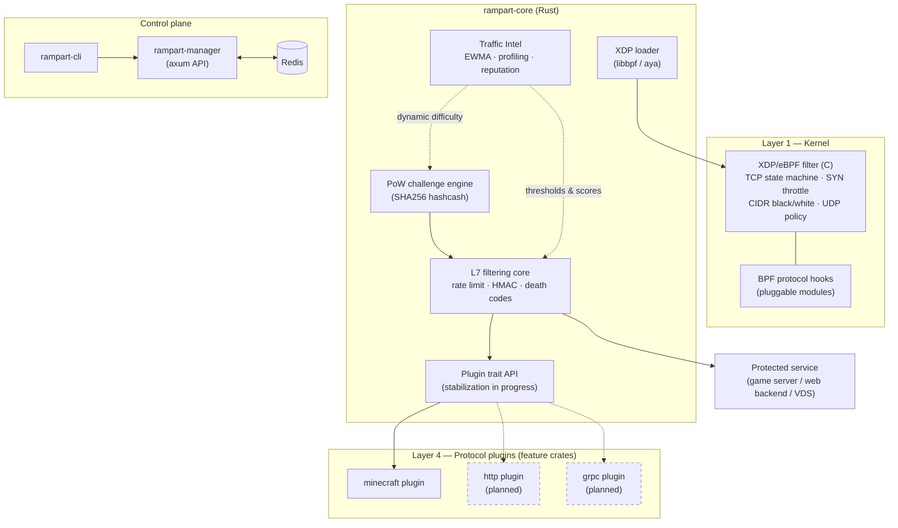

# Architecture — Rampart

> Relevant for: v0.3+ (universal redesign)
> Status: primary design document
> Language: English (research notes) — see [RU summary](#russian-summary) at the end

---

## What changed

Rampart began as a 6-layer, Minecraft-specific protection stack: XDP filter with
hardcoded Minecraft handshake states → PoW → Rust L7 core → Velocity proxy (Java)
→ Paper agent (Java) → Traffic Intel. The big-bang redesign turns it into a
**universal L3/L4/L7 network protection platform** for any TCP service:

- VDS / dedicated servers,
- web services and APIs,
- game servers of any kind (Minecraft is now just a plugin, not the core).

The layer count drops from 6 to 4. Everything protocol-specific is extracted from
the core into compile-time protocol plugins; everything Java-based is removed.

## Layered architecture

```
┌──────────────────────────────────────────────────────────────────────┐
│  LAYER 1: XDP/eBPF (C)            drop L3/L4 before kernel TCP stack │
│  ─────────────────────────────                                       │
│  Universal (protocol-agnostic):                                      │
│    + Generic TCP state machine (SYN → ESTABLISHED lifecycle,         │
│      per-connection seq tracking, bpf_timer idle cleanup)            │
│    + SYN throttle per-IP                                             │
│    + IP/CIDR blacklist + whitelist (LPM_TRIE)                        │
│    + Invalid TCP flags drop (SYN+FIN, SYN+RST, URG, empty)           │
│    + UDP policy (configurable: pass / drop / rate-limit)             │
│    + Pluggable BPF protocol hooks (see ADR-002)                      │
├──────────────────────────────────────────────────────────────────────┤
│  LAYER 2: Universal PoW Challenge (Rust)     anti-handshake-flood    │
│  ─────────────────────────────                                       │
│    SHA256 hashcash over any TCP protocol (see ADR-004):              │
│      1. Edge sends challenge (random + timestamp + difficulty)       │
│      2. Client solves PoW (nonce brute-force)                        │
│      3. Edge verifies SHA256(data + nonce) prefix                    │
│    + Dynamic difficulty: rises when CPS > threshold                  │
│    + Per-connection one-time challenge (nonce replay protection)     │
├──────────────────────────────────────────────────────────────────────┤
│  LAYER 3: Rust Userspace Core                L7 filtering            │
│  ─────────────────────────────                                       │
│    + L7 handshake analysis (via active protocol plugin)              │
│    + Rate limit (token bucket per-IP)                                │
│    + HMAC signatures (constant-time compare)                         │
│    + Death-code patterns (auto-ban on malicious payloads)            │
├──────────────────────────────────────────────────────────────────────┤
│  LAYER 4: Protocol Plugins (compile-time feature crates)             │
│  ─────────────────────────────                                       │
│    + minecraft — first plugin (existing MC-handshake code moved in)  │
│    + http, grpc — planned                                            │
└──────────────────────────────────────────────────────────────────────┘

  TRAFFIC INTEL (cross-cutting, Rust + Redis):
    + EWMA adaptive thresholds
    + Traffic profiling (per-slot baselines)
    + IP reputation system
```

### Traffic path

```
Attacker (botnet)
    |
    v
[1] XDP/eBPF ─── universal TCP state machine ─── CIDR lists ─── SYN throttle
    |           drop: SYN flood, invalid flags, blacklisted CIDRs,
    |                 UDP policy violations, failed BPF hook checks
    v (clean TCP that passed state machine + hooks)
[2] PoW Challenge ─── SHA256 hashcash ─── dynamic difficulty   [OFF by default]
    |           drop: did not solve PoW in time
    v (valid PoW)
[3] Userspace Core ─── plugin handshake parse ─── rate limit ─── death codes
    |           drop: rate limit, malformed packets
    v (validated application-layer client)
[4] Consumer service (game server, web backend, ...)
```

## Component diagram



## Architecture Decision Records

### ADR-004: Compile-time protocol plugins instead of hardcoded Minecraft

**Context.** The Rust userspace core originally parsed only Minecraft handshakes
(VarInt decoding, hostname bounds checks). Every non-Minecraft use case required
forking the codebase.

**Decision.** Protocol-specific parsing moves behind an internal **plugin trait
API** implemented by separate feature crates (`rampart-plugin-minecraft`, later
`rampart-plugin-http`, `rampart-plugin-grpc`). Plugins are selected at compile
time via Cargo features — no dynamic loading, no ABI stability burden. The first
plugin, `minecraft`, receives the existing MC-handshake code as-is.

**Consequences.**

- (+) The core becomes protocol-neutral; one platform covers VDS, web, and games.
- (+) Compile-time selection keeps dispatch static and the hot path monomorphic.
- (−) Supporting multiple protocols simultaneously requires composing feature
  sets per build; runtime protocol multiplexing is out of scope until the plugin
  API stabilizes.
- (−) The trait API must stabilize before third-party plugins appear (roadmap).

### ADR-005: Pluggable BPF hooks instead of hardcoded Minecraft states

**Context.** The XDP program contained a Minecraft-specific TCP state machine:
`AWAIT_ACK → AWAIT_MC_HANDSHAKE → AWAIT_LOGIN → verified`. This made Layer 1
unusable for any non-Minecraft traffic.

**Decision.** The XDP filter keeps only **generic, protocol-agnostic** logic:
a universal TCP lifecycle state machine, SYN throttle, CIDR black/white lists,
TCP-flag sanity checks, and configurable UDP policy. Deep protocol parsing moves
into **separate BPF hook modules** attached to the main filter at load time.
Each hook can inspect payload after the TCP header and return allow/drop/skip.

**Consequences.**

- (+) Layer 1 works for arbitrary TCP services out of the box.
- (+) Hook modules keep the main filter small, auditable, and verifiable.
- (−) Hook attachment adds a map-dispatch indirection on the hot path; measured
  cost is acceptable, but the full benchmark suite is still in progress.
- (−) Hooks are more constrained than userspace parsing (no loops without
  bounded verification); anything complex stays in Layer 3.

### ADR-006: Remove Java layers (Velocity/Paper) and React dashboard

**Context.** Layers 4–5 were Java services: a Velocity proxy performing domain
checks, HMAC verification, physics/CAPTCHA challenges, plus a Paper agent doing
Redis heartbeat and server auto-registration. A React dashboard covered the
control plane UI.

**Decision.** All Java components and the dashboard are removed from the
repository. Consumers integrate with Rampart through the **Manager API**
(axum + Redis sync) instead of embedding proxy-side Java plugins. See
[Migration notes](#migration-notes).

**Consequences.**

- (+) Universality: Rampart no longer assumes Minecraft or the JVM at all;
  it protects whatever sits behind it.
- (+) Dramatically smaller deployment surface: edge nodes are pure Rust + C.
- (−) Capabilities unique to the Java layers (physics checks, in-game CAPTCHA)
  are gone; where needed they become responsibilities of consumer-side plugins
  built against the Manager API.
- (−) Existing Velocity/Paper deployments must migrate or stay on pre-redesign
  git history.

### ADR-007: Universal PoW stays, off by default

**Context.** The SHA256 hashcash challenge previously assumed a Minecraft
text-challenge flow, which vanilla clients could not solve. In the universal
platform the challenge is redefined to work over any TCP protocol.

**Decision.** Keep the PoW layer as a core capability, redesigned as a
protocol-independent challenge, but ship it **disabled by default**
(`pow.enabled = false`). Operators enable it when their client ecosystem can
answer the challenge (custom clients, modded protocols, HTTP integrations).

**Consequences.**

- (+) Anti-handshake-flood capability remains available platform-wide.
- (+) Default configuration never breaks clients that cannot solve PoW.
- (−) Out of the box, handshake floods are mitigated only by Layer 1 throttling
  and Layer 3 rate limits until PoW is explicitly enabled.

### ADR-008: Bilingual knowledge base as documentation-first strategy

**Context.** Operational experience (attack anatomy, defense levels, practice
guides) was scattered across research notes, runbooks, and chat history. New
operators repeatedly rediscovered the same lessons.

**Decision.** Maintain `docs/kb/` as a curated, bilingual (EN/RU) knowledge
base: attack anatomy, defense level explanations, and practice guides.
Documentation-first: every new attack class or defense mechanism gets a KB
entry as part of the change, not after the fact.

**Consequences.**

- (+) Onboarding cost drops; operational decisions cite KB articles.
- (+) EN/RU mirroring serves both the international audience and the original
  Russian-speaking operator community.
- (−) Bilingual maintenance doubles writing effort; entries may temporarily lag
  in one language.

## Migration notes

**Removed from the repository** (recoverable from git history):

- `plugins/` — Java Velocity plugin (domain whitelist, physics checks, CAPTCHA,
  TPS-aware routing) and Paper agent (Redis heartbeat, auto-registration).
- `velocity/`, `paper/` — build scaffolding for the Java layers.
- `dashboard/` — React + Vite + TypeScript control plane UI.

All removed sources remain accessible in git history
(`git log --follow -- plugins/ velocity/ paper/ dashboard/`).

**Moved into the plugin crate:**

- Minecraft handshake parsing (VarInt, bounds checks) from the Rust core →
  `minecraft` protocol plugin crate.
- Minecraft-specific connection states in the XDP state machine → replaced by
  the universal state machine; MC-specific deep parsing will reappear as a BPF
  hook module (planned).

**Kept in place:**

- XDP/eBPF generic filtering (maps, LPM trie, throttle timers).
- SHA256 hashcash PoW engine (redesigned to be protocol-agnostic, off by default).
- Rate limiting, HMAC, death-code pattern matching in the userspace core.
- Traffic Intel (EWMA thresholds, profiling, reputation).
- Manager API (axum) + Redis sync, CLI.

**Integration path for former Java-layer consumers:** talk to rampart-manager's
HTTP API for server registration, blacklists, and event streams. There is no
in-process Java integration anymore.

## Requirements (edge node)

| Item | Requirement |
|------|-------------|
| Virtualization | KVM / Bare Metal (XDP does not work under OpenVZ/LXC; check `systemd-detect-virt`) |
| Kernel | 5.10+ |
| CPU/RAM | 2–4 vCPU, 2–4 GB |
| XDP drivers | native: Intel i40e, Mellanox ConnectX; virtio falls back to generic mode |

## Historical ADRs (pre-redesign, still valid)

- **ADR-001: Rust for the edge core.** Rust + tokio over Go (GC pauses),
  C (memory safety), Java (footprint). Zero-cost abstractions + libbpf-rs.
- **ADR-002: Redis as state store.** Redis + local cache on edge nodes; edges
  keep operating from cache if Redis is down; Redis Cluster/Sentinel for scale/HA.
- **ADR-003: NATS for critical events.** NATS JetStream for blacklist updates,
  attack events, audit log — at-least-once delivery instead of Redis Pub/Sub's
  fire-and-forget.

---

## RU summary (краткая выжимка)

Rampart переработан из 6-слойной Minecraft-специфичной защиты в универсальную
платформу сетевой защиты уровня L3/L4/L7 для любых сервисов. Слоёв стало четыре:
(1) XDP/eBPF в ядре — только протоколо-независимая логика (универсальный TCP
state machine, SYN throttle, CIDR-списки, UDP policy), глубокий парсинг вынесен
в подключаемые BPF hook-модули; (2) универсальный PoW-challenge (SHA256 hashcash)
поверх любого TCP-протокола, выключен по умолчанию; (3) userspace-ядро на Rust —
L7-анализ, rate limit, HMAC, death-code паттерны; (4) компайл-тайм протокол-плагины
(feature crates), первый — minecraft, далее http и grpc. Traffic Intel
(EWMA, профилирование, репутация) работает поперёк всех слоёв. Java-слои
(velocity/paper) и React dashboard удалены — потребители интегрируются через
Manager API (axum + Redis). Документация строится вокруг двуязычной базы знаний
docs/kb. Полные детали миграции и ссылки на git-историю — в Migration notes выше.
